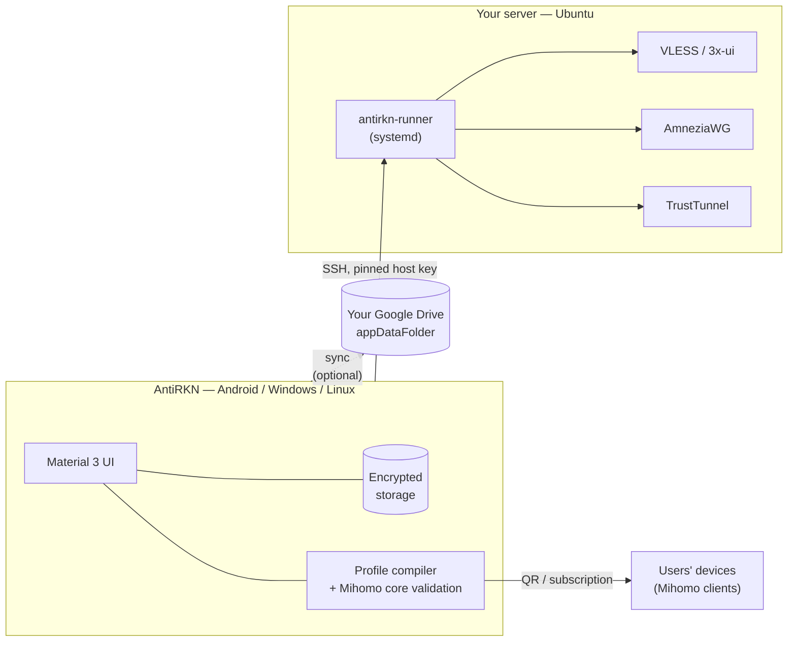

<div align="center">


# AntiRKN

**Your own network infrastructure, from one window.**
Deploy, configure and maintain your own servers without hand-editing configs in a terminal.

[](https://github.com/CyberCat2033/AntiRKN/releases/latest)
[](LICENSE)

[](https://flutter.dev)
[](https://m3.material.io)
[](PRIVACY.md)

[Download](#-install) · [User guide (RU)](USAGE.md) · [Build (RU)](INSTRUCTION.md) · [Changelog](CHANGELOG.md) · [Русский](README.md)

</div>

> [!NOTE]
> AntiRKN is an educational and research tool for administering **your own** servers and learning about network protocols. It is not a VPN service: the project provides no servers and no access to any network or resource. You are responsible for complying with the laws of your country and of the country where your server is located. See the [disclaimer](DISCLAIMER.md).

---

## What it is

AntiRKN is a control panel, not a VPN client. You add your own Ubuntu server; the app installs and configures the components over SSH, keeps track of users and builds ready-to-import [Mihomo](https://github.com/MetaCubeX/mihomo) profiles for them. What usually takes a dozen commands and manual config edits becomes a few taps, with a clear plan of changes shown before anything is applied.

<table>
<tr>
<td width="50%" valign="top">

### 🖥️ Servers
Password, key or SSH agent authentication with host key pinning. The `antirkn-runner` agent runs as a systemd service and applies changes step by step, resuming after a failure.

</td>
<td width="50%" valign="top">

### 🔌 Protocols
**VLESS** (Reality, Vision, XHTTP) via 3x-ui, including adoption of existing inbounds. **AmneziaWG** with tunable packet parameters. **TrustTunnel** with a Certbot certificate or your own files.

</td>
</tr>
<tr>
<td valign="top">

### 👥 Users
One user gets one profile covering all your servers. Changes reach the servers in the background and wait for unreachable ones; traffic is shown per client.

</td>
<td valign="top">

### 📦 Profiles
Self-contained YAML for Mihomo-based clients: groups, routing rules and a per-user base template. Share by QR code or a subscription link.

</td>
</tr>
<tr>
<td valign="top">

### 🔄 Sync
Data moves between your devices through the hidden app folder in **your** Google Drive. Password-encrypted backup files are available too.

</td>
<td valign="top">

### 🔒 Privacy
No backend, no accounts, no telemetry. Data is stored locally and encrypted; secrets never reach the logs. App updates are signed.

</td>
</tr>
</table>

## How it works



## 📥 Install

Builds are published in [**Releases**](https://github.com/CyberCat2033/AntiRKN/releases/latest):

| Platform | File |
|---|---|
| **Android** | `.apk` per ABI (`arm64-v8a`, `armeabi-v7a`, `x86_64`) or universal |
| **Windows** | `.exe` installer or portable `.zip` |
| **Linux** | `.AppImage` or `.tar.gz` |

The app offers updates by itself: the update manifest is signed, files are checked against SHA-256 and APKs against the signing certificate. Every release ships a `SHA256SUMS` file.

**Server requirements:** an Ubuntu VPS (x86_64), `root` or a `sudo` user, open ports for the protocols you choose. TrustTunnel needs a domain pointing at the server.

## 🛠 Build from source

```bash
git clone https://github.com/CyberCat2033/AntiRKN.git
cd AntiRKN
bash tool/build_linux.sh
```

You need Flutter, Go and Python 3. Per-distribution dependencies, manual builds and Google Cloud setup are in [INSTRUCTION.md](INSTRUCTION.md) (Russian). How CI builds and signs releases: [docs/release-ci.md](docs/release-ci.md).

## 📚 Documentation

| | |
|---|---|
| [USAGE.md](USAGE.md) | user guide (Russian) |
| [INSTRUCTION.md](INSTRUCTION.md) | building on Linux and Google Cloud setup (Russian) |
| [CHANGELOG.md](CHANGELOG.md) | what changed in each version |
| [PRIVACY.md](PRIVACY.md) | what data the app uses and where it goes |
| [SECURITY.md](SECURITY.md) | how to report a vulnerability |
| [DISCLAIMER.md](DISCLAIMER.md) | intended use and disclaimer |

## 🤝 Contributing

Bugs and ideas go to [Issues](https://github.com/CyberCat2033/AntiRKN/issues). Report vulnerabilities privately as described in [SECURITY.md](SECURITY.md), not in Issues. Run `tool/verify.sh` before opening a pull request.

## ⚖️ License

AntiRKN is licensed under the [GNU GPL v3.0](LICENSE). The app embeds the [Mihomo](https://github.com/MetaCubeX/mihomo) core (GPL-3.0). Third-party components installed on servers (Xray, 3x-ui, AmneziaWG, TrustTunnel) are distributed under their own licenses; their authors are not affiliated with this project.

The software is provided "as is", without any warranty. See [DISCLAIMER.md](DISCLAIMER.md).
