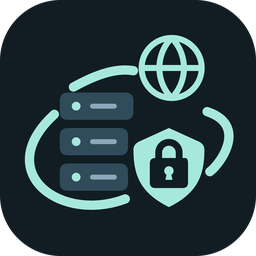
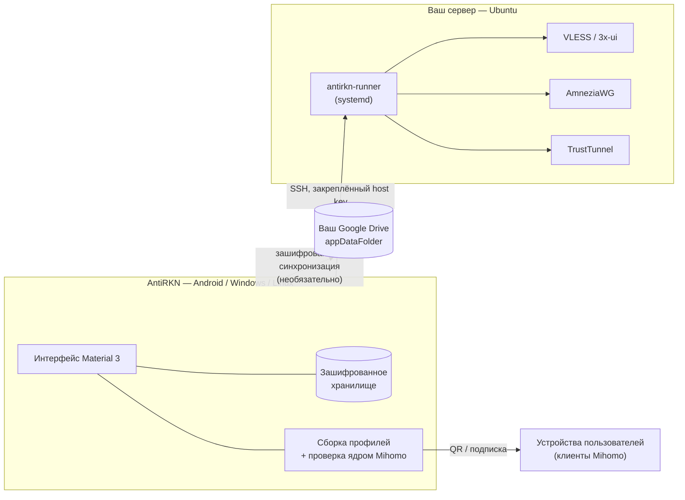

<div align="center">



# AntiRKN

**Своя сетевая инфраструктура — из одного окна.**
Разверните, настройте и обслуживайте собственные серверы без ручной работы в терминале.

[](https://github.com/CyberCat2033/AntiRKN/releases/latest)
[](LICENSE)

[](https://flutter.dev)
[](https://m3.material.io)
[](PRIVACY.md)

[Скачать](#-установка) · [Руководство](USAGE.md) · [Сборка](INSTRUCTION.md) · [Изменения](CHANGELOG.ru.md) · [English](README.en.md)

</div>

> [!NOTE]
> AntiRKN — учебный и исследовательский инструмент для администрирования **ваших собственных** серверов и изучения сетевых протоколов. Это не VPN-сервис: проект не предоставляет серверы, доступ к сети или каким-либо ресурсам. Вы отвечаете за соблюдение законов своей страны и страны, где размещён сервер. Подробно — в [отказе от ответственности](DISCLAIMER.md).

---

## Что это

AntiRKN — панель управления, а не VPN-клиент. Вы добавляете свой сервер на Ubuntu, а приложение по SSH ставит и настраивает нужные компоненты, ведёт список пользователей и собирает для них готовые профили [Mihomo](https://github.com/MetaCubeX/mihomo). Всё, что обычно делается десятком команд и правкой конфигов вручную, здесь — несколько нажатий с понятным планом изменений перед применением.

<table>
<tr>
<td width="50%" valign="top">

### 🖥️ Серверы
Подключение по паролю, ключу или SSH-агенту, закрепление host key. Агент `antirkn-runner` работает на сервере как служба systemd и применяет изменения пошагово, с возобновлением после сбоя.

</td>
<td width="50%" valign="top">

### 🔌 Протоколы
**VLESS** (Reality, Vision, XHTTP) через 3x-ui, в том числе с подхватом уже созданных inbound. **AmneziaWG** с настраиваемыми параметрами пакетов. **TrustTunnel** с автоматическим TLS-сертификатом.

</td>
</tr>
<tr>
<td valign="top">

### 👥 Пользователи
Один пользователь — один профиль на все его серверы и протоколы. Доступы, отключение и отзыв применяются одним планом, статистика трафика видна по каждому клиенту.

</td>
<td valign="top">

### 📦 Профили
Самодостаточный YAML для клиентов на ядре Mihomo: группы, правила маршрутизации, свой базовый шаблон для каждого пользователя. Раздача QR-кодом или ссылкой на подписку.

</td>
</tr>
<tr>
<td valign="top">

### 🔄 Синхронизация
Рабочее пространство шифруется на устройстве и синхронизируется между вашими устройствами через папку приложения в **вашем** Google Drive. Есть локальные зашифрованные бэкапы.

</td>
<td valign="top">

### 🔒 Приватность
Нет своего бэкенда, аккаунтов и телеметрии. Данные хранятся локально и зашифрованы, секреты не попадают в логи. Обновления приложения подписаны.

</td>
</tr>
</table>

## Как это устроено



## 📥 Установка

Готовые сборки лежат в [**Releases**](https://github.com/CyberCat2033/AntiRKN/releases/latest):

| Платформа | Файл |
|---|---|
| **Android** | `.apk`: под архитектуру (`arm64-v8a`, `armeabi-v7a`, `x86_64`) или universal |
| **Windows** | установщик `.exe` или portable `.zip` |
| **Linux** | `.AppImage` или `.tar.gz` |

Приложение само предлагает обновиться: манифест обновлений подписан, файлы проверяются по SHA-256, а APK — по сертификату подписи. Контрольные суммы всех файлов лежат в `SHA256SUMS` к каждому релизу.

**Что нужно для сервера:** VPS на Ubuntu (x86_64), доступ `root` или пользователь с `sudo`, открытые порты для выбранных протоколов. Для TrustTunnel нужен домен, указывающий на сервер.

## 🛠 Сборка из исходников

```bash
git clone https://github.com/CyberCat2033/AntiRKN.git
cd AntiRKN
bash tool/build_linux.sh
```

Понадобятся Flutter, Go и Python 3. Зависимости по дистрибутивам, ручная сборка и настройка Google Cloud для синхронизации — в [INSTRUCTION.md](INSTRUCTION.md). Как CI собирает и подписывает релизы — в [docs/release-ci.md](docs/release-ci.md).

<details>
<summary><b>Структура репозитория</b></summary>

```
apps/manager/          Flutter-приложение
packages/
  design_system/       тема, компоненты и motion Material 3
  domain/              чистая доменная логика (без dart:io и Flutter)
  profile_compiler/    сборка профилей Mihomo
  ssh_transport/       SSH, закрепление ключей, поставка runner
  storage/             зашифрованное SQLite-хранилище
  sync/                синхронизация и публикация
  integrations/        Google Drive и OAuth
  mihomo_runtime/      связь с нативным ядром Mihomo
  network_inventory/   сведения о сетевых интерфейсах
native/mihomo/         обёртка над ядром Mihomo (Go)
server/runner/         серверный агент antirkn-runner (Python 3, stdlib)
schemas/               JSON-схемы, из которых генерируются контракты
tool/                  сборка, генераторы, проверки (verify.sh)
```

</details>

## 📚 Документация

| | |
|---|---|
| [USAGE.md](USAGE.md) | руководство пользователя: серверы, протоколы, клиенты, профили, синхронизация |
| [INSTRUCTION.md](INSTRUCTION.md) | сборка под Linux и настройка Google Cloud |
| [CHANGELOG.ru.md](CHANGELOG.ru.md) | что изменилось в каждой версии |
| [PRIVACY.md](PRIVACY.md) | какие данные использует приложение и куда они уходят |
| [SECURITY.md](SECURITY.md) | как сообщить об уязвимости |
| [DISCLAIMER.md](DISCLAIMER.md) | назначение проекта и отказ от ответственности |

## 🤝 Участие

Баг или идея — в [Issues](https://github.com/CyberCat2033/AntiRKN/issues). Об уязвимостях пишите не в Issues, а приватно, как описано в [SECURITY.md](SECURITY.md). Перед pull request запустите `tool/verify.sh`.

## ⚖️ Лицензия

AntiRKN распространяется по лицензии [GNU GPL v3.0](LICENSE). В приложение встроено ядро [Mihomo](https://github.com/MetaCubeX/mihomo) (GPL-3.0). Сторонние компоненты, которые ставятся на сервер (Xray, 3x-ui, AmneziaWG, TrustTunnel), распространяются по своим лицензиям, и их авторы не связаны с проектом.

Программа поставляется «как есть», без каких-либо гарантий. См. [DISCLAIMER.md](DISCLAIMER.md).
