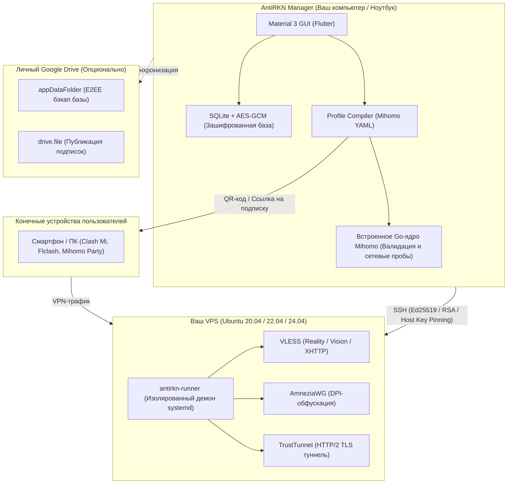

# AntiRKN

<div align="center">


**Центр управления персональной VPN-инфраструктурой нового поколения**

[](INSTRUCTION.md)
[](https://flutter.dev)
[](https://dart.dev)
[](native/mihomo)
[](server/runner)
[](https://m3.material.io)
[](PRIVACY.md)

[**Быстрый старт**](#быстрый-старт-linux) •
[**Инструкция по сборке**](INSTRUCTION.md) •
[**Руководство пользователя**](USAGE.md) •
[**Политика конфиденциальности**](PRIVACY.md)

</div>

---

## 📖 О проекте

**AntiRKN** — это мощное графическое приложение с открытым исходным кодом для развертывания, настройки и централизованного администрирования собственной VPN-инфраструктуры на личных виртуальных серверах (VPS).

> [!IMPORTANT]
> **AntiRKN — это панель управления инфраструктурой, а не VPN-клиент.**
> Приложение берет на себя всю рутину по настройке серверов через защищенный SSH-канал, конфигурирует современные протоколы обхода блокировок, генерирует клиентские ключи и компилирует самодостаточные профили для приложений на базе **Mihomo (Clash.Meta)**, **Flclash**, **Clash Mi**, **Sing-box** и др.

### Ключевая концепция:
- **Zero-Cloud & Zero-Telemetry:** Никаких центральных серверов, аналитики или сторонних баз данных. Все данные хранятся только локально на вашем компьютере в зашифрованном виде (SQLite + AES-GCM).
- **Zero-Touch Server Provisioning:** Никаких ручных bash-скриптов в терминале сервера. AntiRKN разворачивает на целевой Ubuntu изолированный системный демон `antirkn-runner` в строгой песочнице systemd и управляет им через зашифрованный IPC.
- **Работа офлайн:** Все функции управления серверами, генерации конфигураций и раздачи по QR-кодам работают на 100% автономно без подключения к сторонним сервисам.

---

## 🚀 Архитектура решения



---

## ⚡ Возможности

| Направление | Функционал |
|---|---|
| **Управление серверами** | Неограниченное число серверов Ubuntu x86_64; SSH аутентификация по паролю, приватным ключам или системному SSH-агенту; закрепление host key; инвентаризация интерфейсов и портов. |
| **VLESS** | Xray / 3x-ui; маскировка Reality под TLS 1.3; режимы Vision и XHTTP (Split HTTP); бесшовное согласование (adoption) существующих инбаундов из 3x-ui; маршрутизация клиентского выхода (Client Egress). |
| **AmneziaWG** | Защита от блокировок ТСПУ за счет настраиваемой обфускации пакетов (`Jc`, `Jmin`, `Jmax`, `S1`, `S2`, `H1`-`H4`); оптимизация `keepalive: 0` для сохранения батареи смартфонов. |
| **TrustTunnel** | Скоростной HTTPS-туннель; автоматический выпуск и перевыпуск TLS-сертификатов Let's Encrypt / ZeroSSL через встроенный ACME-клиент. |
| **Управление клиентами** | Добавление пользователей и устройств в один клик; распределение доступов по серверам и протоколам; индивидуальные шаблоны маршрутизации (`baseConfig`). |
| **Экспорт конфигов** | Генерация самодостаточных YAML-профилей Mihomo (Clash.Meta) с умным разделением трафика (прямой доступ к РФ ресурсам, блокировка рекламы); живые QR-коды. |
| **Синхронизация** | Опциональная E2EE синхронизация рабочего пространства между устройствами через Google Drive `appDataFolder`; экспорт зашифрованных локальных бэкапов (`.antirkn`). |

---

## 🛠 Быстрый старт (Linux)

### 1. Установка системных зависимостей

Для сборки требуются стандартные библиотеки сборки C++, GTK 3, Secret Service, Flutter SDK, Go и Python 3:

```bash
# Для Ubuntu / Debian:
sudo apt update && sudo apt install -y \
  clang cmake ninja-build pkg-config libgtk-3-dev libsecret-1-dev \
  libjsoncpp-dev libsqlite3-dev liblzma-dev python3 golang-go git curl
```

*(Инструкции для Fedora, Arch Linux и ручной настройки Flutter смотрите в [INSTRUCTION.md](INSTRUCTION.md))*

### 2. Сборка одной командой

Склонируйте репозиторий и запустите автоматизированный сборочный скрипт:

```bash
git clone https://github.com/CyberCat2033/AntiRKN.git
cd AntiRKN
bash tool/build_linux.sh
```

Скрипт автоматически проверит все системные зависимости, скомпилирует нативное Go-ядро, проверит динамическую линковку библиотек (`ldd`) и создаст готовый к запуску релизный архив в `apps/manager/build/releases/`.

### 3. Запуск

```bash
cd apps/manager/build/linux/x64/release/bundle
./antirkn_manager
```

---

## 📚 Документация

- 📘 [**INSTRUCTION.md**](INSTRUCTION.md) — Исчерпывающее руководство по сборке под Linux, установке всех тулчейнов, решению проблем компиляции и пошаговой настройке Google Cloud Console (Drive API, OAuth Desktop Client, Picker API).
- 📗 [**USAGE.md**](USAGE.md) — Подробное иллюстрированное руководство пользователя: подключение VPS по SSH, настройка VLESS/Reality, AmneziaWG и TrustTunnel, создание клиентов, генерация QR-кодов, разрешение конфликтов синхронизации.
- 🔒 [**PRIVACY.md**](PRIVACY.md) — Политика конфиденциальности, гарантии отсутствия сбора пользовательских данных и принципы сквозного шифрования.

---

## 📁 Структура монорепозитория

```
AntiRKN/
├── apps/
│   └── manager/             # Основное графическое Flutter-приложение (GUI)
├── packages/
│   ├── design_system/       # Дизайн-система Material Design 3, компоненты, цвета
│   ├── domain/              # Чистая бизнес-логика (серверы, клиенты, протоколы)
│   ├── integrations/        # Интеграция с Google Drive REST API и Desktop OAuth
│   ├── mihomo_runtime/      # Обертка для взаимодействия с нативным ядром Mihomo
│   ├── network_inventory/   # Сканер сетевых интерфейсов и портов
│   ├── profile_compiler/    # Компилятор конфигураций Mihomo YAML и WireGuard
│   ├── ssh_transport/       # SSH-транспорт (dartssh2), пиннинг ключей, бандл раннера
│   ├── storage/             # Локальное зашифрованное хранилище SQLite и ключи
│   └── sync/                # E2EE координатор синхронизации и очередей публикации
├── native/
│   └── mihomo/              # Исходный код ядра валидатора Mihomo (Go)
├── server/
│   └── runner/              # Серверный агент antirkn-runner (Python 3 daemon)
├── schemas/                 # JSON-схемы валидации и release lock раннера
└── tool/
    ├── build_linux.sh       # Автоматизированный скрипт сборки и упаковки релиза
    ├── check_workspace.py   # Быстрый валидатор архитектуры и локализации
    └── verify.sh            # Полный набор тестов и статического анализа
```

---

## 🔒 Безопасность и проверка кода

В проекте реализован строгий контроль качества и архитектурных границ:
- **Контроль слоев архитектуры:** Пакеты доменного слоя (`domain`, `sync`, `profile_compiler`) изолированы от платформенных зависимостей (`dart:io`, `dart:ui`).
- **Синхронизация локализации:** Валидатор проверяет совпадение всех 1100+ RU/EN строк и подстановок.
- **Проверка перед коммитом:**
  ```bash
  python3 tool/check_workspace.py
  python3 tool/generate_runner.py --check
  flutter analyze --no-pub
  ```

---

## 📄 Лицензия

Проект распространяется для личного и некоммерческого использования в соответствии с правилами безопасности персональных данных. Исходный код ядра Mihomo лицензирован под GNU General Public License v3.0.
